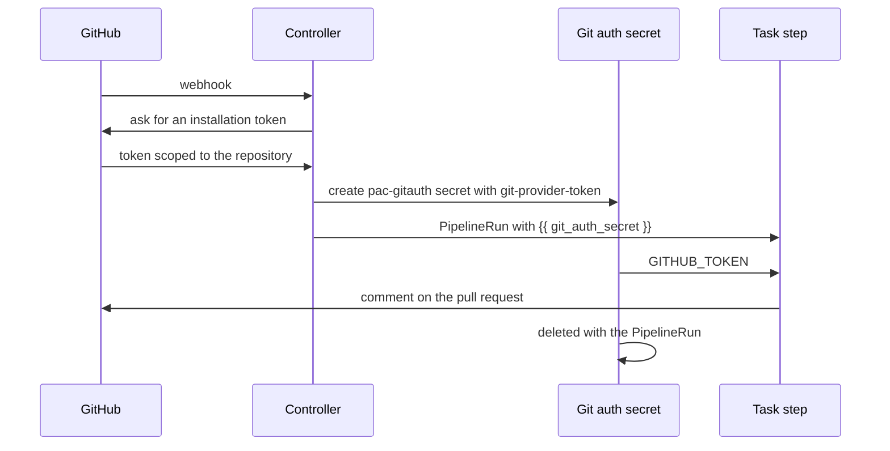

This page explains how to use the temporary GitHub App installation token that Pipelines-as-Code generates, so you can interact with the GitHub API from your PipelineRuns. Use this when your pipeline needs to post comments, update statuses, or call other GitHub endpoints.

## Accessing the token

Pipelines-as-Code generates a temporary installation token from the GitHub App for each PipelineRun. You can use this token to access the GitHub API. The token value is stored in the temporary git-auth secret that Pipelines-as-Code generates for [private repositories](), under the key `git-provider-token`.



## Refreshing a token after a queue wait

When a queue clears `PipelineRunPending`, PaC checks the expiry of its GitHub.com App token. If the token has five minutes or less left, PaC issues a replacement using the usual repository and global scoping rules, then saves it in the same Secret before the run starts. If refresh fails, the run stays pending for retry.

Refresh needs Kubernetes 1.28 or later (OpenShift 4.15 or later). Clusters on Kubernetes 1.27 or OpenShift 4.14 and earlier aren't supported.

## Adding a comment to a pull request

To add a comment to a pull request, use the [github-add-comment](https://artifacthub.io/packages/tekton-task/tekton-catalog-tasks/github-add-comment) task from [Artifact Hub](https://artifacthub.io) (a public registry for discovering Tekton tasks and other cloud-native artifacts) with a [Pipelines-as-Code annotation]():

```yaml
pipelinesascode.tekton.dev/task: "github-add-comment"
```

Then add the task to your [tasks section](https://tekton.dev/docs/pipelines/pipelines/#adding-tasks-to-the-pipeline) (or [finally](https://tekton.dev/docs/pipelines/pipelines/#adding-finally-to-the-pipeline) tasks) of your PipelineRun:

```yaml
[...]
tasks:
  - name:
      taskRef:
        name: github-add-comment
      params:
        - name: REQUEST_URL
          value: "{{ repo_url }}/pull/{{ pull_request_number }}"
        - name: COMMENT_OR_FILE
          value: "Pipelines-as-Code IS GREAT!"
        - name: GITHUB_TOKEN_SECRET_NAME
          value: "{{ git_auth_secret }}"
        - name: GITHUB_TOKEN_SECRET_KEY
          value: "git-provider-token"
```

Because this configuration uses dynamic variables, it works for any pull request across any repository without modification.

## Setting GITHUB_TOKEN as an environment variable

You can also set the `GITHUB_TOKEN` environment variable directly on a task step. This approach is useful when you want to call the GitHub API from a custom script rather than a dedicated task:

```yaml
env:
  - name: GITHUB_TOKEN
    valueFrom:
      secretKeyRef:
        name: "{{ git_auth_secret }}"
        key: "git-provider-token"
```



- On GitHub Apps, the generated installation token [expires after one hour](https://docs.github.com/en/apps/creating-github-apps/authenticating-with-a-github-app/authenticating-as-a-github-app-installation).
- On GitHub Apps, Pipelines-as-Code scopes the token to the repository the event originates from, unless you [configure it differently]() on the cluster.
- To restrict the token to specific extra repositories or understand scoping in detail, see [GitHub Token Scoping]().


