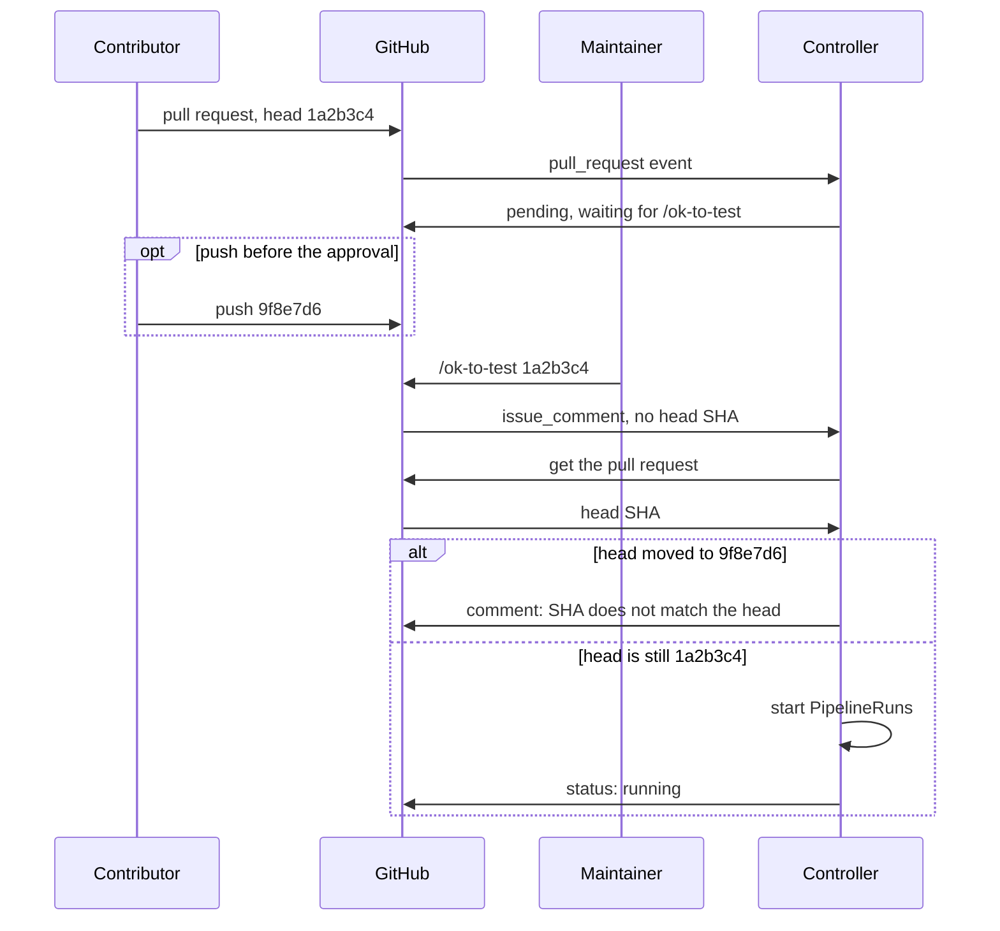

GitOps commands let you control Pipelines-as-Code from pull request (PR) comments and comments on pushed commits. Use them to retest failures, cancel running pipelines, or trigger specific PipelineRuns without leaving your Git provider's interface.

PR commands stay in the pull request's comment history, and push commands stay in the commit's comment history.

## GitOps Commands on Pull Requests

To restart failed PipelineRuns on a PR, add a comment starting with `/retest`. Pipelines-as-Code restarts all **failed** PipelineRuns attached to that PR. If all previous PipelineRuns for the same commit succeeded, Pipelines-as-Code does not create new PipelineRuns, avoiding unnecessary duplication.

Example:

```text
Thanks for contributing. This is a much-needed bugfix, and we appreciate it ❤️ The
failure is not with your PR but seems to be an infrastructure issue.

/retest
```

**What it does:** The `/retest` command creates new PipelineRuns only when:

- Previously **failed** PipelineRuns exist for the same commit, OR
- No PipelineRun has run for the same commit yet

If a successful PipelineRun already exists for the same commit, `/retest` **skips** it to avoid unnecessary duplication. When PipelineRuns have been pruned from the cluster (for example, by a retention policy), Pipelines-as-Code falls back to querying the Git provider's commit status API to determine which pipelines previously succeeded, ensuring only failed pipelines are re-run even when the original PipelineRun objects no longer exist.

```mermaid
flowchart LR
%% title: What /test and /retest comments start on a pull request
  Dev@{ img: "/icons/user.svg", label: "Maintainer", w: 48, h: 48, constraint: "on" }
  ACL@{ img: "/icons/policy.svg", label: "Access check", w: 48, h: 48, constraint: "on" }
  Match@{ img: "/icons/filter.svg", label: "Match .tekton/", w: 48, h: 48, constraint: "on" }
  Named[Pick by name]
  Hist@{ img: "/icons/search.svg", label: "Past results", w: 48, h: 48, constraint: "on" }
  Run@{ img: "/icons/pipeline.svg", label: "PipelineRuns", w: 48, h: 48, constraint: "on" }
  Note@{ img: "/icons/chat.svg", label: "Reply comment", w: 48, h: 48, constraint: "on" }
  Dev -->|comment| ACL
  ACL --> Match
  ACL --> Named --> Run
  Match all@-->|/test| Run
  Match -->|/retest| Hist
  Hist failed@-->|some failed| Run
  Hist passed@-->|all passed| Note

%% play: /retest
%% skip Named Note
%% Dev -> ACL : /retest | A maintainer comments /retest on the pull request, and the controller checks the sender can run CI
%% ACL -> Match | The PipelineRuns matching the pull request are selected
%% Match -> Hist | Earlier runs for this commit are read from the cluster, or from the commit statuses once they were pruned
%% Hist -> Run @failed : failed only | Only the PipelineRuns that failed, or never ran, start again
%% play: Everything passed
%% skip Named Run
%% Dev -> ACL : /retest
%% ACL -> Match
%% Match -> Hist
%% Hist -> Note @passed | Nothing to rerun, so a comment suggests /retest with a name or /test
%% play: /test
%% skip Named Hist Note
%% Dev -> ACL : /test
%% ACL -> Match
%% Match -> Run @all : all | Every matching PipelineRun starts, whatever its last result
%% play: Named PipelineRun
%% skip Match Hist Note
%% Dev -> ACL : /retest docs
%% ACL -> Named | /test or /retest with a name skips the annotation matching
%% Named -> Run : docs | The named PipelineRun always starts, even if it passed before
```

**When to use it:** To force a rerun regardless of previous status, use:

```text
/retest <pipelinerun-name>
```

This always triggers a new PipelineRun, even if previous runs succeeded.

Similarly, the `/ok-to-test` command only triggers new PipelineRuns when no successful PipelineRun already exists for the same commit. This prevents duplicate runs when repository owners repeatedly test the same commit with `/test` and `/retest` commands.

### Requiring a SHA with `/ok-to-test`




**What it does:** This setting forces reviewers to include the commit SHA when approving external contributions, closing a timing window that could otherwise let unreviewed code run in CI.

**Why it exists:** GitHub's `issue_comment` event does not include the pull request's HEAD SHA (unlike other Git providers). Without the SHA, an attacker could push a new commit immediately after an owner comments `/ok-to-test`, causing CI to run on unintended code. Requiring the commit ID eliminates this risk.

To enable this protection, cluster administrators set `require-ok-to-test-sha: "true"` in the Pipelines-as-Code ConfigMap. When enabled, repository owners and collaborators must append a 7-40 character Git SHA (in lowercase or uppercase hexadecimal) to the command. For example:

```text
/ok-to-test 1A2B3C4
```

Pipelines-as-Code verifies the provided SHA against the pull request's current HEAD:

- Short SHAs must match the HEAD commit's prefix.
- Full SHAs must match exactly.

If the SHA is missing or invalid, Pipelines-as-Code rejects the comment and replies with instructions to retry using the correct value. Other Git providers already include the commit SHA in their webhook payloads, so this protection applies only to GitHub.



### Targeting Specific PipelineRuns

**What it does:** The `/test` command followed by a PipelineRun name restarts only that specific PipelineRun.

**When to use it:** You have multiple PipelineRuns on a PR and only need to rerun one of them. For example:

```text
Pipeline execution appears to be unstable due to external factors. Retesting this specific pipeline.

/test <pipelinerun-name>
```


GitOps commands such as `/test` and others do not work on closed pull requests or merge requests.


### Edited Comments




By default, Pipelines-as-Code only processes **newly created** comments. If you edit an existing comment to add or change a GitOps command, it is ignored.

When the `support-edited-comments` setting is enabled in the [Pipelines-as-Code ConfigMap](), edited comments are processed just like new ones. This means you can edit a comment to fix a typo in a command or change a PipelineRun name, and Pipelines-as-Code triggers the updated command.

To enable this feature, set the following in the `pipelines-as-code` ConfigMap:

```yaml
support-edited-comments: "true"
```

Pipelines-as-Code fetches pull request details from the GitHub API before checking a comment for GitOps commands. Enabling edited comment support also makes this API request for each processed comment edit, including edits to ordinary comments or commands intended for other CI systems. Each request counts toward the API rate limit of the token used by Pipelines-as-Code.


Enabling edited comment support means that editing any comment on a pull request that contains a GitOps command (such as `/test` or `/retest`) will re-trigger the associated PipelineRuns. Be cautious when editing older comments that contain commands.

