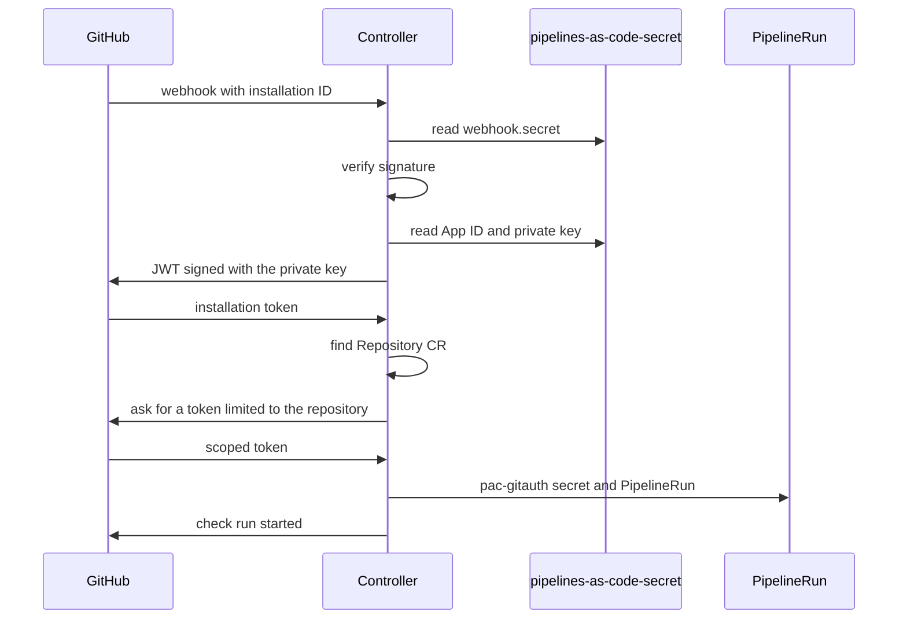

This page covers how to configure Pipelines-as-Code with a GitHub App. Use this method when you want the richest integration with GitHub, including the CheckRun API, GitOps comments, and automatic token management. A GitHub App is the recommended approach for most GitHub users, and you typically need only one per cluster.

## Prerequisites

- A running Pipelines-as-Code [installation]()
- Admin access to a GitHub account or organization
- The public URL of your Pipelines-as-Code controller route or ingress endpoint

## Setup using the CLI

Use the [`tkn pac bootstrap`]() command to create a GitHub App, configure it with your Git repository, and create the required secrets automatically. After creating the GitHub App, install it on the repositories you want to use with Pipelines-as-Code.

If you prefer to configure everything by hand, follow the [manual setup](#manual-setup) steps below.

## Manual Setup

To create the GitHub App manually:

- Go to <https://github.com/settings/apps> (or *Settings > Developer settings > GitHub Apps*) and click on the **New GitHub
  App** button
- Provide the following information in the GitHub App form:
  - **GitHub Application Name**: `OpenShift Pipelines`
  - **Homepage URL**: *[OpenShift Console URL]*
  - **Webhook URL**: *[the Pipelines-as-Code route or ingress URL as copied in the previous section]*
  - **Webhook secret**: *[an arbitrary secret, you can generate one with `head -c 30 /dev/random | base64`]*

- Select the following repository permissions:
  - **Checks**: `Read & Write`
  - **Contents**: `Read & Write`
  - **Issues**: `Read & Write`
  - **Metadata**: `Readonly`
  - **Pull request**: `Read & Write`

- Select the following organization permissions:
  - **Members**: `Readonly`

- Subscribe to following events:
  - Check run
  - Check suite
  - Commit comment
  - Issue comment
  - Pull request
  - Push
  - Release


> You can see a screenshot of how the GitHub App permissions look like [here](https://user-images.githubusercontent.com/98980/124132813-7e53f580-da81-11eb-9eb4-e4f1487cf7a0.png)


- Click on **Create GitHub App**.

- Take note of the **App ID** at the top of the page on the **General** tab, under **About**, for the GitHub App you just created.

- In the **Private keys** section, click on **Generate Private key** to generate a private key for the GitHub app. It downloads automatically. Store the private key in a safe place because you need it in the next section and when reconfiguring this app for a different cluster.

### Configure Pipelines-as-Code to access the GitHub App

Pipelines-as-Code needs a Kubernetes secret containing the GitHub App private key and the webhook secret. This secret lets the controller [generate tokens](https://docs.github.com/en/developers/apps/building-github-apps/identifying-and-authorizing-users-for-github-apps) on behalf of the user who triggered the event and validate incoming webhook payloads.

Here is how the controller uses that secret for each event:



Run the following command, replacing the placeholder values:

- `APP_ID` with the GitHub App **App ID** copied in the previous section
- `WEBHOOK_SECRET` with the webhook secret provided when you created the GitHub App
- `PATH_PRIVATE_KEY` with the path to the private key that was downloaded in the
  previous section

```bash
kubectl -n pipelines-as-code create secret generic pipelines-as-code-secret \
        --from-literal github-private-key="$(cat $PATH_PRIVATE_KEY)" \
        --from-literal github-application-id="APP_ID" \
        --from-literal webhook.secret="WEBHOOK_SECRET"
```

Finally, install the App on the repositories you want to use with Pipelines-as-Code.

## Notes

- GitHub.com requires no additional configuration.
- For a self hosted instance such as GitHub Enterprise Server, the hostname must
  be trusted by the controller before it will send credentials to it. See
  [Trusted provider hostnames]().

### Trusting a self hosted GitHub instance

Pipelines-as-Code only sends its Git provider credentials to hostnames it
trusts, listed in the `trusted-provider-hostnames` key of the controller
ConfigMap (`pipelines-as-code` by default):

```bash
kubectl -n pipelines-as-code patch configmap pipelines-as-code \
  --type merge -p '{"data":{"trusted-provider-hostnames":"ghe.example.com"}}'
```

The value is a comma separated list, so several instances can be trusted at
once, which is what you want when a single controller serves more than one self
hosted provider:

```yaml
trusted-provider-hostnames: "ghe.example.com, gitlab.example.com"
```

While the key is empty, the public hostnames (`github.com`, `gitlab.com`,
`bitbucket.org`, `gitea.com`, `codeberg.org`) stay trusted and the controller
records the hostname of every webhook whose signature it verified in the
`pipelinesascode.tekton.dev/auto-trusted-provider-hostnames` ConfigMap
annotation. This keeps a default installation working without configuration,
and a controller serving several instances learns all of them.

A non-empty list is authoritative for every hostname, public ones included, and
the controller stops learning hosts. Listing only `ghe.example.com` is how you
make sure the controller never talks to `github.com`.

The automatic trust only covers webhooks GitHub signed:
[incoming webhooks]() carry
no signature and will fail until the hostname is trusted. Setting the key
explicitly is therefore the recommended setup for any self hosted instance.

A hostname that is not routable on the public internet (loopback, a private
range, or an in-cluster `.svc` name) is never recorded automatically: list it
explicitly to trust it.

```mermaid
flowchart LR
%% title: How the controller decides whether to trust a GitHub hostname
  Hook@{ img: "/icons/webhook.svg", label: "Signed App webhook", w: 48, h: 48, constraint: "on" }
  Inc@{ img: "/icons/terminal.svg", label: "Incoming webhook", w: 48, h: 48, constraint: "on" }
  Key@{ img: "/icons/config.svg", label: "Trusted hosts", w: 48, h: 48, constraint: "on" }
  Public[Public host]
  Learn@{ img: "/icons/audit.svg", label: "Auto-trusted annotation", w: 48, h: 48, constraint: "on" }
  Use@{ img: "/icons/unlock.svg", label: "Credentials sent", w: 48, h: 48, constraint: "on" }
  No@{ img: "/icons/refuse.svg", label: "Refused", w: 48, h: 48, constraint: "on" }
  Hook --> Key
  Inc --> Key
  Key pub@-->|empty| Public --> Use
  Key learn@-->|empty| Learn --> Use
  Key listed@-->|listed| Use
  Key -->|not trusted| No

%% play: github.com, key empty
%% skip Inc Learn No
%% Hook -> Key : github.com
%% Key -> Public @pub | Public hostnames stay trusted while the key is empty
%% Public -> Use
%% play: Enterprise, key empty
%% skip Inc Public No
%% Hook -> Key : ghe.example.com | The signature was verified with the App webhook secret
%% Key -> Learn @learn | so the controller records the hostname in the ConfigMap annotation
%% Learn -> Use
%% play: Key set
%% skip Inc Public Learn No
%% Hook -> Key : ghe.example.com
%% Key -> Use @listed | A non-empty list decides alone and the controller stops learning hosts
%% play: Key set, host missing
%% skip Inc Public Learn Use
%% Hook -> Key : github.com
%% Key -> No | A host missing from a non-empty list is refused, public ones included
%% play: Incoming webhook
%% skip Hook Public Learn Use
%% Inc -> Key : ghe.example.com | An incoming webhook has no signature, so it never teaches the controller a host
%% Key -> No | Until the host is trusted, the request is refused
```

If a hostname is not trusted, the controller refuses the request and logs the
exact command to run:

```text
refusing to use credentials with the "ghe.example.com" host: it is not listed in
the "trusted-provider-hostnames" key of the pipelines-as-code/pipelines-as-code
ConfigMap. Add it with: kubectl -n pipelines-as-code patch configmap ...
```

After migrating to a new hostname, replace the value with the new one. Removing
a hostname from a non-empty list immediately stops the controller from talking
to it. Emptying the key gives the policy back to the controller and makes its
previously learned hosts effective again; delete the auto-trusted annotation as
well to forget them.

If the controller ConfigMap is managed by GitOps tooling (Argo CD, the
OpenShift Pipelines operator through `TektonConfig`, ...), set
`trusted-provider-hostnames` in the source of truth. Otherwise a reconciler that
prunes controller-owned annotations makes the controller relearn the hostname
on every signed webhook.
